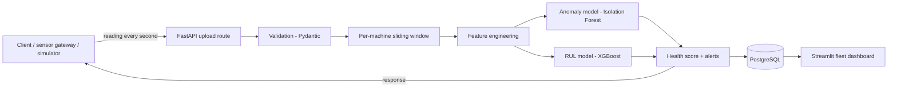

# Real-Time Crane Health Monitoring and Predictive Maintenance System

A predictive maintenance system built around a real-time ingestion API. Any client (a sensor gateway, a script or a simulator) uploads a crane's sensor reading every second. The API scores each reading on arrival with two models and returns the result: an anomaly flag, a health score and a "service needed in X days" forecast. A live dashboard ranks the fleet by risk.

See [interview.md](interview.md) for the problem, motivation, competition and design reasoning, and [project.md](project.md) for the original brief.

## How it works

1. A reading has a `machine_id`, a `timestamp` and four signals: `hoist_load` (t), `motor_temp` (°C), `vibration` (mm/s RMS) and `duty_cycle` (%).
2. The API validates it (types, ranges, required fields, no unknown fields) and appends it to that machine's 30-reading window.
3. It builds 17 features from the window: last value, mean, standard deviation and trend for each signal, plus the share of vibration energy in the upper half of the spectrum.
4. **Isolation Forest** flags unusual behaviour. **XGBoost** predicts remaining useful life (RUL) in days.
5. Health score (0–100) = predicted RUL as a share of 60 days, halved while the reading is flagged as anomalous.
6. An alert (`anomaly` or `service_due` when RUL < 7 days) is raised after 3 readings in a row and cleared after 3 clear readings, so one noisy reading doesn't flip it.
7. The reading, its scores and any alerts are stored. The dashboard refreshes from the API every 3 minutes (`REFRESH_SECONDS` in [crane/dashboard.py](crane/dashboard.py)); reload the page to refresh sooner.
